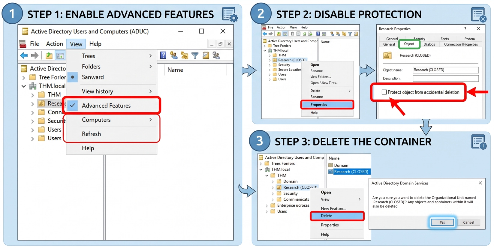
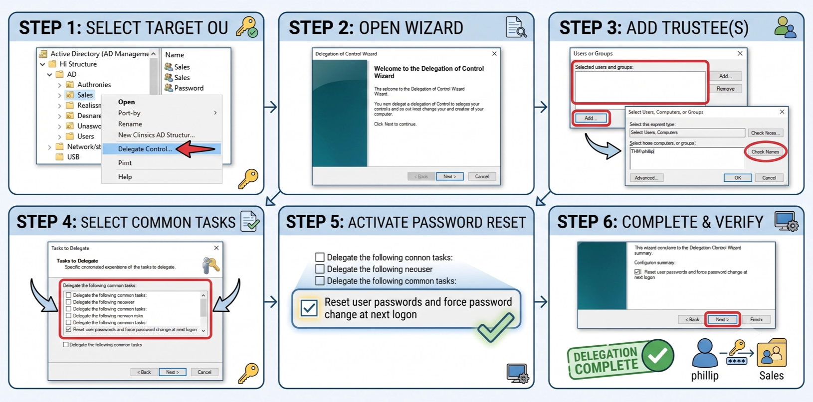
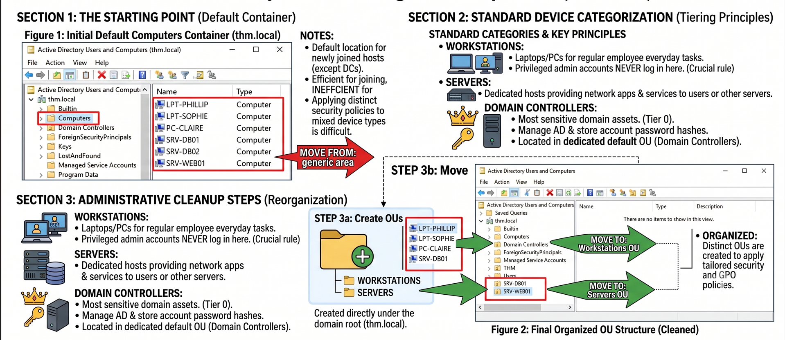

# Active Directory Evidence

These are the original screenshots from my controlled course lab environment. They show the Active Directory tasks covered in my notes. The images are included directly below so they can be reviewed without searching through separate files.

## 1. Deleting a protected OU

This screenshot documents the OU deletion-protection task.

[Open the original full-size screenshot](01-deleting-protected-ou.png)

## 2. ADUC delegation of control

This screenshot documents the delegation-of-control task in Active Directory Users and Computers.

[Open the original full-size screenshot](02-aduc-delegation-of-control.png)

## 3. Managing computers in Active Directory

This screenshot documents the computer-management task in Active Directory.

[Open the original full-size screenshot](03-managing-computers-in-ad.png)

## Source

[6. Active Directory & Windows Domain](https://app.notion.com/p/3b6f055fceba80b28ca4f08a5f542f54)

**Lab scope:** These screenshots are from a simulated, controlled learning environment. They are included as original course evidence and should not be interpreted as real-world organizational data or a production deployment.
