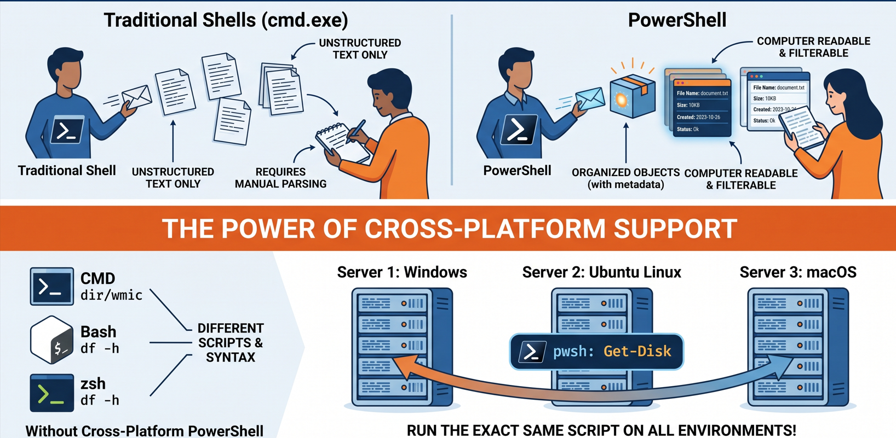
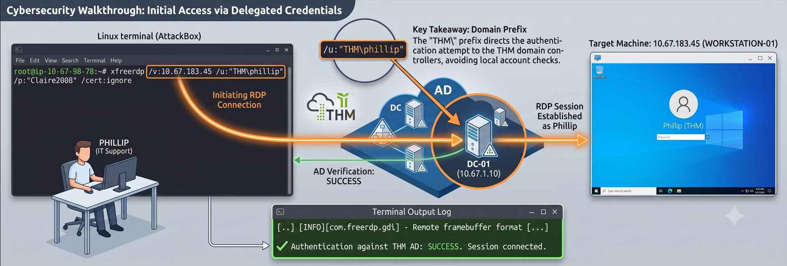
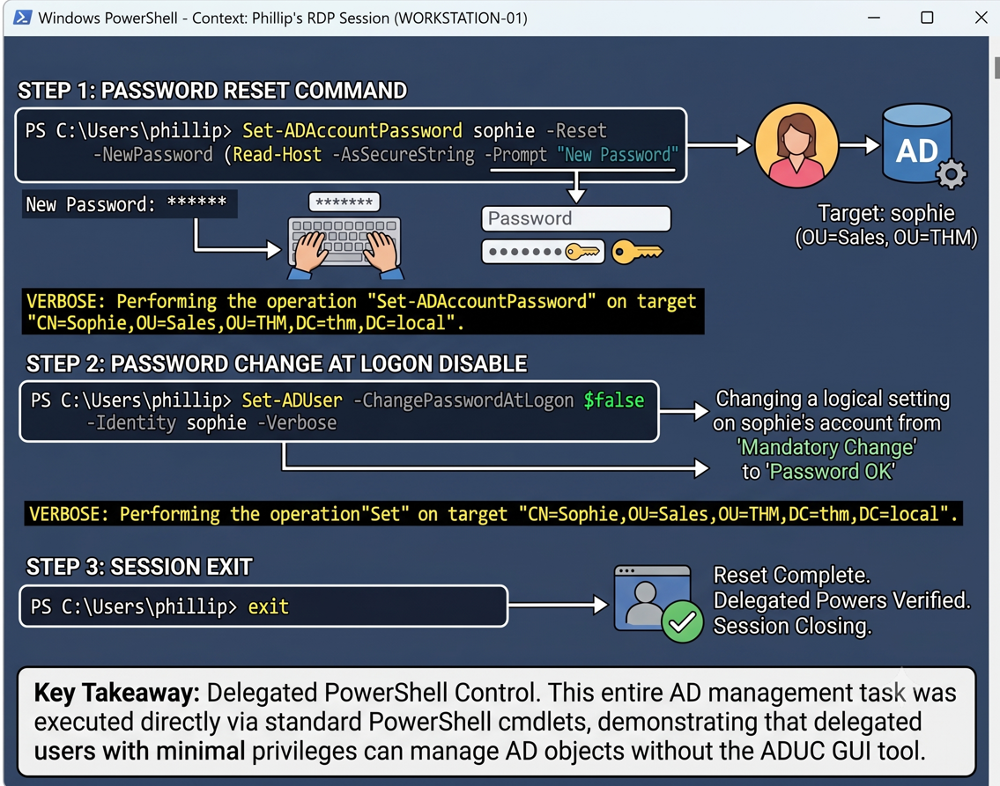
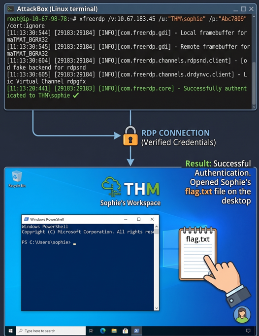

# PowerShell Administration Evidence

These are the original screenshots from my controlled course lab environment. They document PowerShell fundamentals and the delegated support workflow shown in my Active Directory lab.

## 1. PowerShell object pipeline

This screenshot relates to working with PowerShell objects and the pipeline.

[Open the original full-size screenshot](01-powershell-object-pipeline.png)

## 2. Remote session as support user Phillip

This screenshot shows the remote session associated with the support account Phillip.

[Open the original full-size screenshot](02-rdp-session-support-phillip.png)

## 3. Delegated password reset with PowerShell

This screenshot documents the delegated password-reset step using the Active Directory PowerShell module. I have kept the original screenshot rather than recreating the command or its parameters in this page.

[Open the original full-size screenshot](03-powershell-delegated-password-reset.png)

## 4. Target login verification

This screenshot documents the login verification step after the password-reset workflow.

[Open the original full-size screenshot](04-target-login-verification.png)

## Source

[6. Active Directory & Windows Domain](https://app.notion.com/p/3b6f055fceba80b28ca4f08a5f542f54)  
[8. Powershell](https://app.notion.com/p/3b9f055fceba8092be37e7a3c98ed0c3)

**Lab scope:** These screenshots are from a simulated, controlled learning environment. They are included as original course evidence and should not be interpreted as real-world organizational data or a production support environment.
