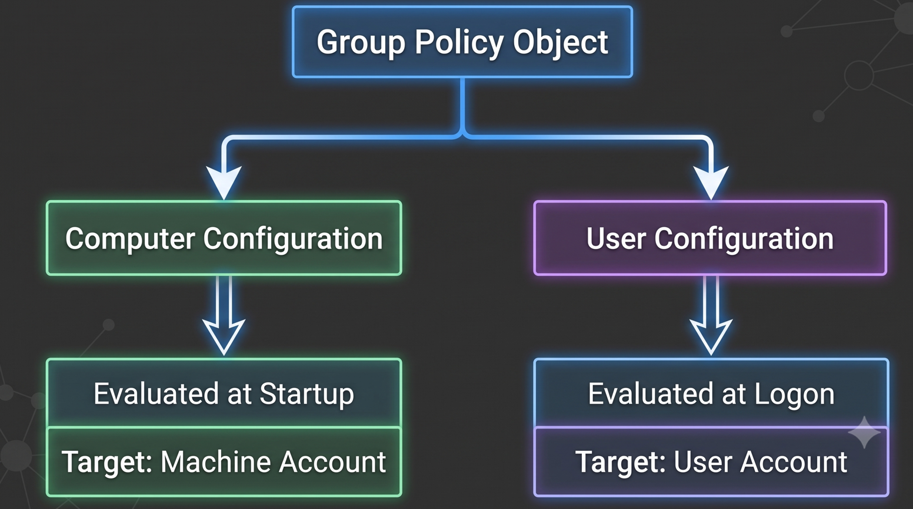
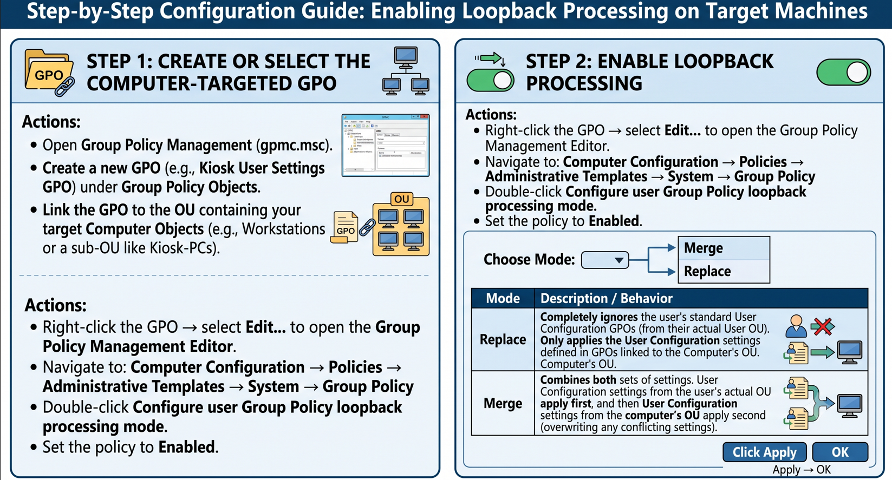
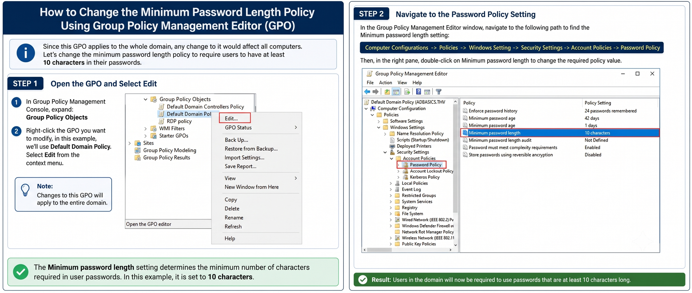
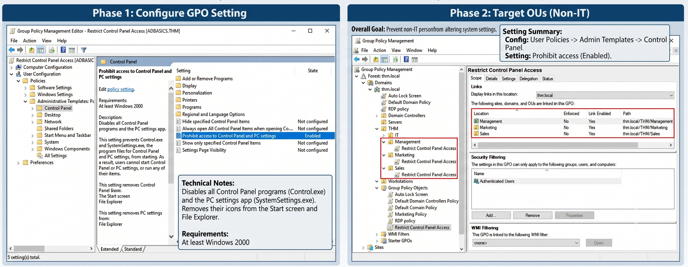
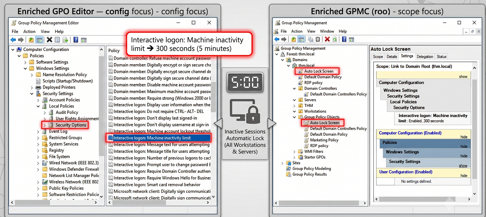

# Group Policy Evidence

These are the original screenshots from my controlled course lab environment. They show the Group Policy configuration topics covered in my Active Directory notes.

## 1. GPO computer and user configuration

This screenshot documents the computer and user configuration areas of Group Policy.

[Open the original full-size screenshot](01-gpo-computer-user-configuration.png)

## 2. GPO loopback processing

This screenshot documents the Group Policy loopback-processing topic.

[Open the original full-size screenshot](02-gpo-loopback-processing.png)

## 3. GPO password policy

This screenshot documents the password-policy configuration.

[Open the original full-size screenshot](03-gpo-password-policy.png)

## 4. Restricting Control Panel

This screenshot documents the Control Panel restriction configured through Group Policy.

[Open the original full-size screenshot](04-gpo-restrict-control-panel.png)

## 5. Automatic screen lock

This screenshot documents the automatic screen-lock configuration.

[Open the original full-size screenshot](05-gpo-automatic-screen-lock.png)

The lab notes also cover using `gpupdate /force` to request a Group Policy refresh.

## Source

[6. Active Directory & Windows Domain](https://app.notion.com/p/3b6f055fceba80b28ca4f08a5f542f54)

**Lab scope:** These screenshots are from a simulated, controlled learning environment. They are included as original course evidence and should not be interpreted as real-world organizational data or a production policy deployment.
