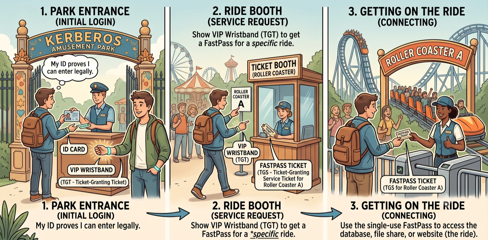
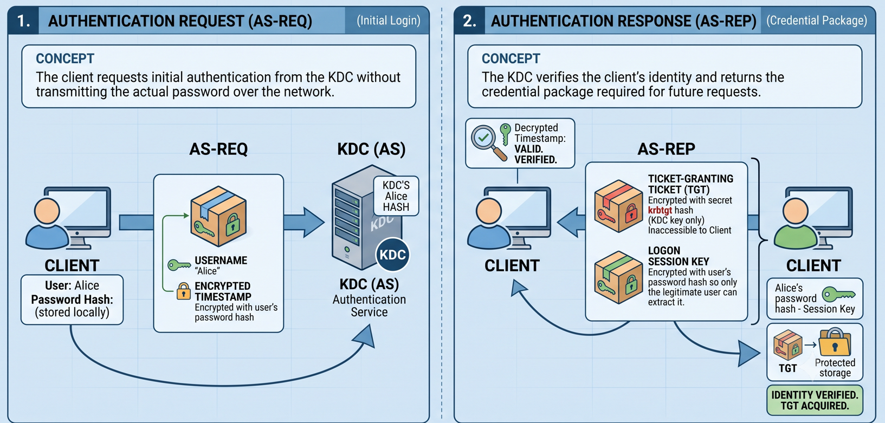
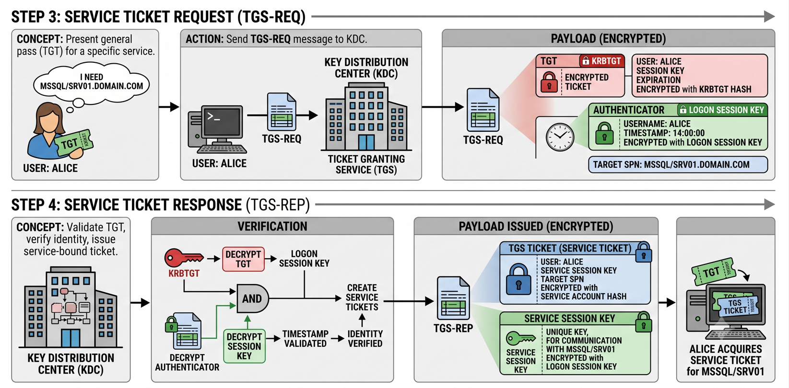
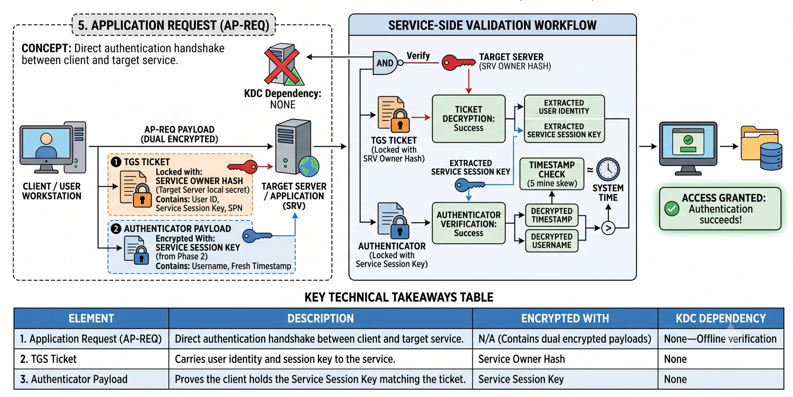
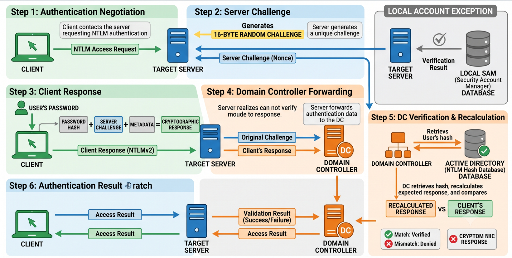

# Authentication Diagram Evidence

These are the original diagrams from my course learning material. I have included each image directly so the Kerberos stages and NetNTLM challenge-response flow can be viewed in context.

## 1. Kerberos overview

[Open the original full-size diagram](01-kerberos-overview-diagram.png)

## 2. Kerberos phase 1: TGT

[Open the original full-size diagram](02-kerberos-phase1-tgt.png)

## 3. Kerberos phase 2: TGS

[Open the original full-size diagram](03-kerberos-phase2-tgs.png)

## 4. Kerberos phase 3: AP-REQ

[Open the original full-size diagram](04-kerberos-phase3-ap-req.png)

## 5. NetNTLM challenge-response

[Open the original full-size diagram](05-netntlm-challenge-response.png)

## Source

[6. Active Directory & Windows Domain](https://app.notion.com/p/3b6f055fceba80b28ca4f08a5f542f54)

**Lab scope:** These are course-learning diagrams used to explain authentication concepts. They are included as supplied and are not representations of captured authentication traffic from a real organization.
